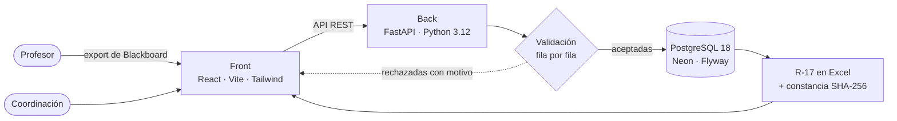

### Jefferson Sanchez Palacios

Ingeniería de Sistemas en la Universidad de Lima, décimo superior · Lima, Perú

  

<table>
<tr>
<td width="50%" valign="top">

**🇵🇪 Español**

Estudiante de Ingeniería de Sistemas en la Universidad de Lima, en el décimo superior, con dos años previos de Ingeniería Biomédica. Construyo sistemas web y móviles de punta a punta, con la base de datos, las pruebas y el despliegue como parte del trabajo y no como un paso final.

Dos de mis sistemas están en producción en la universidad: el inventario de insumos químicos fiscalizados por SUNAT y la medición de resultados para la acreditación **ABET**. Fuera del código, toco la viola.

</td>
<td width="50%" valign="top">

**🇺🇸 English**

Systems Engineering student at Universidad de Lima, in the top 10% of my class, with two prior years of Biomedical Engineering. I build web and mobile systems end to end, treating the database, tests and deployment as part of the work, not as a final step.

Two of my systems run in production at the university: an inventory of SUNAT-regulated chemicals and an outcomes-measurement platform for **ABET** accreditation. Away from the keyboard, I play the viola.

</td>
</tr>
</table>

> **Abierto a · Open to:** prácticas y roles full-stack, DevOps o de datos · full-stack, DevOps and data internships or roles.

### 🔭 Actualmente

- 👨‍💻 **Practicante de Tecnología de Procesos** en la Universidad de Lima desde julio de 2026. Desarrollo el sistema web de insumos químicos fiscalizados por SUNAT, en producción desde agosto, con React, TypeScript, una API en Hono y PostgreSQL. El código vive en repos privados.
- 📊 **Sistema de medición ABET** para la Carrera de Ingeniería Ambiental, en producción desde noviembre de 2026.
- 🤖 **MLOps** con DVC, MLflow y GitHub Actions sobre un clasificador de phishing, en el curso de DevOps.
- 🎓 Cursos de 2026-2 en DevOps, Seguridad de Sistemas, Planeamiento Estratégico y Paradigmas de Programación.

### 🧭 Facetas

### 📁 Proyectos destacados

#### ⭐ Proyecto estrella · Sistema de medición ABET

Sistema web con el que los profesores de Ingeniería Ambiental de la Universidad de Lima cargan las evaluaciones de Blackboard y obtienen el reporte R-17 que pide la acreditación ABET. Yo defino el producto, escribo y apruebo las especificaciones y reviso cada cambio, y la implementación es asistida por IA con Claude Code.

| | Función | Qué hace |
| :---: | :--- | :--- |
| 📥 | **Carga del export** | El profesor sube el export de Blackboard de su sección y ve qué filas se aceptan y cuáles se rechazan, con el motivo. |
| 🔁 | **Carga sin duplicados** | Cada carga entra en una sola transacción, y el mismo archivo nunca se publica dos veces. |
| 📊 | **Reporte R-17** | Genera el Excel del R-17 desde la base, con una constancia que guarda la huella SHA-256 del archivo. |
| 👥 | **Roles** | El profesor ve solo sus secciones y la coordinación ve todas las cargas. |
| 🔐 | **Privacidad** | Ningún nombre de estudiante se guarda ni se muestra, y el repositorio solo usa datos inventados. |
| 🧪 | **Trazabilidad** | Nueve especificaciones; las dos últimas cruzan 32 historias de usuario y 237 escenarios con sus pruebas. |
| ⚙️ | **DevOps** | CI en GitHub Actions, migraciones con Flyway, SonarQube Cloud, respaldo programado de la base y versiones publicadas. |

#### Más proyectos

<b>📱 ULima++ · app académica full-stack</b>

 

App móvil del curso Ingeniería de Software II para consultar la vida académica en la Universidad de Lima.

| | |
| :--- | :--- |
| **Stack** | Flutter · GetX · Bun · Hono · Drizzle ORM · PostgreSQL · Vercel |
| **Lo que hice** | Autenticación con JWT y roles, la malla curricular interactiva y la API REST de 27 tablas, con 45 commits, la mayor contribución del equipo |
| **Repos** | [ULima_Frontend_IS2](https://github.com/jeffangeloss/ULima_Frontend_IS2) · [ULima_Backend_IS2](https://github.com/jeffangeloss/ULima_Backend_IS2) |

<b>🤖 MLOps para la detección de phishing</b>

 

Proyecto final del curso de DevOps (2026-2, grupo 04), que lleva a producción el clasificador CatBoost de URL de phishing con 20 características léxicas del conjunto PhiUSIIL. Está en construcción.

| | |
| :--- | :--- |
| **Stack** | Python 3.11 · CatBoost · DVC · MLflow · GitHub Actions · FastAPI |
| **Antecedente** | El modelo del curso de Machine Learning llegó a un F1 de 0,9998 |
| **Repo** | [mlops-phishing-g4](https://github.com/jeffangeloss/mlops-phishing-g4) |

<b>🧾 Punto de venta para un negocio familiar</b>

 

Sistema a medida para la liquidación y la cobranza diaria de Inversiones Sánchez, que atiende a más de 40 vendedores.

| | |
| :--- | :--- |
| **Stack** | Next.js · Prisma · SQLite |
| **Resultado** | Redujo en 90 % las inconsistencias en los montos cobrados |
| **Repo** | [Software-optimizacion-cobro-sanchez](https://github.com/jeffangeloss/Software-optimizacion-cobro-sanchez) |

<b>🎵 Tesis · instrumento de medición en un juego rítmico</b>

 

Instrumento de medición de la tesis sobre un motor de juego rítmico, que registra la telemetría del ritmo y señales biométricas.

| | |
| :--- | :--- |
| **Stack** | Haxe · Python · MQTT |
| **Repo** | [Propuesta](https://github.com/jeffangeloss/Propuesta) |

### 💬 Pregúntame sobre...

- **DevOps:** integración continua con GitHub Actions, migraciones con Flyway, análisis con SonarQube Cloud y despliegue en Vercel.
- **Bases de datos:** modelos en PostgreSQL con restricciones que validan los datos en la propia base.
- **Apps móviles:** Flutter con GetX, mapas y roles.
- **IoT:** ESP32, segundo factor TOTP y sensores.
- **Seguridad:** ISO/IEC 27001, NIST CSF 2.0, OWASP y MASVS.
- **Música:** la viola, la orquesta y cómo se cruzan con el ritmo en la tesis.

### ⚡ Datos curiosos

- 🎻 Toqué con Juan Diego Flórez en «Una Sola Fuerza» (Estadio Nacional, 2017) con Sinfonía por el Perú.
- 🧬 Llegué a Sistemas después de dos años de Ingeniería Biomédica en la PUCP y la UPCH.
- 🏆 Mis trabajos quedaron entre los 20 mejores de la feria de pósteres ExpoSistemas en 2024-2 y 2025-1.
- 📡 Lideré el área de IoT de IEEE ComSoc en la rama estudiantil de la UPC durante 2025.
- 🍸 Tengo la certificación en Bar y Coctelería de la Shaker Bartender School (2023).

### 🧰 Tecnologías

<b>Y también</b> 
               

### 🎼 Partitura de contribuciones

Se regenera cada día con un flujo propio de GitHub Actions, sin servicios externos.

### 📊 Estadísticas de GitHub

Las calcula el mismo flujo diario con la API de GitHub, sin servicios externos.

### 🌸 Animes favoritos

