### Jefferson Sanchez Palacios

Ingeniería de Sistemas en la Universidad de Lima, décimo superior · Lima, Perú

  

Estudiante de Ingeniería de Sistemas con dos años previos de Ingeniería Biomédica. Construye sistemas web y móviles de punta a punta, con la base de datos, las pruebas y el despliegue como parte del trabajo y no como un paso final.

### 🔭 Actualmente

- 👨‍💻 **Practicante de Tecnología de Procesos** en la Universidad de Lima desde julio de 2026. Desarrolla el sistema web de insumos químicos fiscalizados por SUNAT, en producción desde agosto, con React, TypeScript, una API en Hono y PostgreSQL. El código vive en repos privados.
- 📊 **Piloto de medición ABET** para la Carrera de Ingeniería Ambiental, todavía en vista previa y con datos inventados.
- 🎓 Cursos de 2026-2 en DevOps, Seguridad de Sistemas, Planeamiento Estratégico y Paradigmas de Programación.

### 🧭 Facetas

### 📁 Proyectos destacados

| Proyecto | Qué es | Stack |
|---|---|---|
| [ABET-ULIMA-Back](https://github.com/jeffangeloss/ABET-ULIMA-Back) | Carga el export de Blackboard en PostgreSQL y genera el reporte R-17 de cada sección | FastAPI · PostgreSQL 18 · Flyway · GitHub Actions |
| [ULima_Backend_IS2](https://github.com/jeffangeloss/ULima_Backend_IS2) | API de ULima++, la app académica del curso Ingeniería de Software II | Bun · Hono · Drizzle · PostgreSQL |
| [Software-optimizacion-cobro-sanchez](https://github.com/jeffangeloss/Software-optimizacion-cobro-sanchez) | Punto de venta para la liquidación y la cobranza diaria de un negocio familiar | Next.js · Prisma · SQLite |
| [Propuesta](https://github.com/jeffangeloss/Propuesta) | Instrumento de medición de la tesis sobre un motor de juego rítmico | Haxe · Python · MQTT |

### 💬 Pregúntame sobre...

- **DevOps:** integración continua con GitHub Actions, migraciones con Flyway, análisis con SonarQube Cloud y despliegue en Vercel.
- **Bases de datos:** modelos en PostgreSQL con restricciones que validan los datos en la propia base.
- **Apps móviles:** Flutter con GetX, mapas y roles.
- **IoT:** ESP32, segundo factor TOTP y sensores.
- **Seguridad:** ISO/IEC 27001, NIST CSF 2.0, OWASP y MASVS.
- **Música:** la viola, la orquesta y cómo se cruzan con el ritmo en la tesis.

### ⚡ Datos curiosos

- 🎻 Tocó con Juan Diego Flórez en «Una Sola Fuerza» (Estadio Nacional, 2017) con Sinfonía por el Perú.
- 🧬 Llegó a Sistemas después de dos años de Ingeniería Biomédica en la PUCP y la UPCH.
- 🏆 Quedó entre los 20 mejores trabajos de la feria de pósteres ExpoSistemas en 2024-2 y 2025-1.
- 📡 Lideró el área de IoT de IEEE ComSoc en la rama estudiantil de la UPC durante 2025.
- 🍸 Tiene la certificación en Bar y Coctelería de la Shaker Bartender School (2023).

### 🧰 Tecnologías

**Lenguajes**
    

**Web y móvil**
    

**DevOps y datos**
    

### 🎼 Partitura de contribuciones

Se regenera cada día con un flujo propio de GitHub Actions, sin servicios externos.

### 🌸 Animes favoritos

